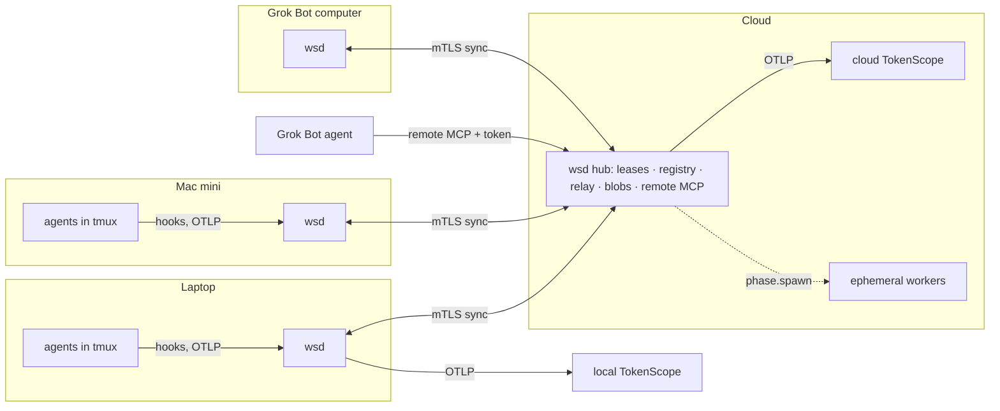

# WS architecture: v6 (2026-10-16)

## What changed from v5
- **Hub and spokes, not a peer mesh.** A cloud hub (the same `wsd` binary in `hub` role) is the lease authority, the device registry, the relay and the remote MCP host. Devices sync only with the hub. Peer-to-peer sync is gone.
- **Single-writer logs, no CRDTs.** Every log has exactly one writer: the lease holder writes a session's log, and the sender writes `message.sent` in its own log. Merging is a union, and the hub rejects appends that carry a stale epoch.
- **The hub is never required to run work.** If the hub is down, every device keeps running its sessions offline. Only failover, moves, cross-device sync and remote MCP stop.
- **Resume is turn-level.** `wsd` takes a checkpoint at every agent turn end. Work from a turn that was in progress at a crash is "in doubt" and resumes as `blocked_on: human`. There is no per-tool intent/commit for external effects. Tool hooks still record pre/post events for the timeline.
- **Capability check replaces `env_hash` equality.** Hash equality stays as a fast path only.
- **The agent transcript is an opaque, content-addressed artifact.** WS syncs and verifies it. WS does not rebuild the conversation.
- **Telemetry comes from the agents.** Claude Code and Codex export their own OTel to a local `wsd` OTLP receiver, tagged with `ws.*` resource attributes. WS adds the `ws.session.*` semantics.
- **tmux stays the PTY host.** `wsd` owns the metadata, the lifecycle and the logs.
- **The Loop merges by becoming ws sessions.** The orchestrator and every phase runner are ws sessions linked by `depends_on`. The Loop scripts stay at first and call the ws API.
- **Own PKI, no Tailscale.** A root key in 1Password signs short-lived device certificates. mTLS goes to the hub.
- **Quota is per account, not per device.** The hub merges readings per account.
- **Phase 0 (spikes)** de-risks the assumptions that no amount of design can settle.
- The remote MCP moves to phase 3, because it needs the hub and device auth.

## Goals
1. Merge the terminal loop into WS as a first-class part. `ws top` shows the current session's loop live.
2. Give coding agents a control surface (local MCP + `ws … --json`) to drive and orchestrate WS.
3. Expose WS as OpenTelemetry, as TokenScope's primary data source.
4. Carry cross-session semantics (`ws.session.*` semconv v1) on OTLP itself. There is no second protocol.
5. Make WS distributed and offline-first. Sessions move between devices and fail over automatically when their device goes quiet. This applies to every kind of session.
6. One cockpit: TokenScope sees every session on every device.
7. Only registered devices can sync, hold leases or export.

Non-goal: merging WS and TokenScope.

## Decisions (2026-10-16)
| # | Decision |
|---|---|
| D1 | We write `wsd` and `ws` in Rust: one cargo workspace and one binary with `daemon`, `hub` and CLI modes. |
| D2 | tmux stays the PTY host. |
| D3 | The lease authority is one always-on node: the cloud hub. |
| D4 | One failover mechanism for all kinds of session. Defaults differ by kind: headless sessions fail over automatically, and interactive sessions stay pinned and move only on `ws session move`. Each session can override both defaults. (An interactive session has no human on the target device, so automatic failover could only restore it idle.) |
| D5 | No Tailscale. WS runs its own PKI with mTLS to the hub. |
| D6 | Cloud workers use the subscriptions (Claude, Codex), not API keys. |
| D7 | Session ids are ULIDs. `#N` aliases come from per-device blocks that the hub leases, so they also work offline. |
| D8 | Read is explicit (`ws ack`), with an implicit `message.read` at turn end. A message to a done session reopens it. (These carry over from v5.) |
| D9 | The client encrypts checkpoints (tree bundles, transcripts). The hub stores ciphertext only. |
| D10 | The hub runs on a cheap VPS (DigitalOcean or Hetzner). Cloudflare may front it with a tunnel. |
| D11 | Heartbeat 10 s, lease TTL 60 s. A sleep hook releases headless leases before the device sleeps. |
| D12 | The hub owns no plan state. The plan lives in the orchestrator session's log on the local `wsd`. Phase 2 retires the loop-web daemon, and the Observatory becomes a viewer over the `wsd` API. |
| D13 | The partition default for headless sessions is `continue`. Headless phases restart from a checkpoint, and git push rejection limits duplicate pushes. `partition: freeze` stays as a per-session option. |
| D14 | `ws device away` hands off every headless session to another device before planned offline time. Interactive sessions stay pinned. It ships in 4a. |
| D15 | Telemetry retention is 30 days on each device and full history on the hub. A device pulls message content only when it has a local sink. |
| D16 | A sink stores its own cursor per source device. When a sink has no cursor, `wsd` replays the full retention window. Dedup by `event_id` makes the replay safe. |
| D17 | The hub runs at most 3 concurrent cloud workers by default (the current Loop lane cap). Config can change the limit. |

## 1. Topology

- Devices dial out to the hub, so NAT and firewalls are not a problem.
- Two devices on the same LAN with no hub do not sync with each other. This is an accepted limit (LAN sync can come later).
- Hub deployment: a single cheap VPS (DigitalOcean or Hetzner, D10) running `wsd hub`. Storage is SQLite for the index plus a blob store (local disk, then S3-compatible). A daily backup of SQLite plus blobs goes to object storage, and `ws hub restore` rebuilds a hub from it. Losing the hub disk loses every lease, so the backup exists from phase 3.
- Revocation needs no CRL: every connection goes through the hub, which checks the registry per connection.
- Cloudflare Workers cannot run the hub (no long-lived process, SQLite file or blob disk). A Cloudflare tunnel in front of the VPS is optional.

## 2. `wsd` (Rust) on each device
- **Runtime:** tokio. The local API is HTTP + JSON over a Unix socket. MCP uses the `rmcp` crate. Storage is per-session append-only JSONL logs plus a SQLite index for queries.
- **tmux driver:** creates windows and panes, pastes input and watches pane liveness, as `ws/lib` does today. The PTYs stay in tmux, so reattach after a terminal crash already works.
- **Session kinds:**
  - `interactive`: an agent in a tmux pane. Claude Code/Codex hooks call `ws hook <event>`.
  - `headless`: a process that `wsd` supervises (e.g. a Loop runner `claude -p`), with its output in the session directory.
- **Session state machine:** `created → running ⇄ blocked → finished | failed`, plus `reopened`.
- **Modules:** registry (sessions, workspaces, aliases), log writer, message bus, trigger/edge engine, checkpointer. Also telemetry (OTLP receiver, telemetry log, forwarder), quota collector, notifier, sync client, MCP server.
- **Migration:** `ws` keeps its current command names and flags. A one-time import reads `$WS_HOME/sessions/*`. We retire the zsh `ws/` scripts module by module. The picker can stay zsh + fzf over `ws … --json` until we port it.

## 3. Sessions and logs
- **Log entry:** `{event_id (ULID), session_id, epoch, seq, prev_hash, ts (ms), type, body, device_id, sig}`. `prev_hash` chains the entries, and the device key signs them.
- **Single-writer rule:**
  - Only the current lease holder (at the current epoch) appends to a session's log.
  - Messages: the sender writes `message.sent` in its own log. The recipient writes `message.delivered` and `message.read` in its own log.
  - The hub accepts an append only when the epoch is the current one. Appends with a stale epoch become an **orphaned branch**. The hub keeps them and shows them for review, and never merges them into the main line.
- **Derived views:** inbox, timeline, edges, `ws top` and telemetry are all projections of the logs.
- **Edges:** `depends_on`, `block_on` and `parent` are log events. `ws on … done|exit --send-to|--spawn` is sugar for "edge + action on satisfaction". Cycle checks run over the replicated edge graph.

## 4. The Loop inside WS
- **Phase 1:** the Loop orchestrator and each phase runner become ws sessions.
  - `loop-runner.sh` starts its runner through `ws session create --headless --parent <orch> --depends-on …`.
  - `loop-emit.sh` stays unchanged in phase 1. Phase 2 moves the loop-web API into `wsd` (D12), so `loop-emit.sh` then talks to `wsd` at the same URL.
- In phase 1, `ws top` finds the current session's loop and runs `loop-top` for it. From phase 2, `loop-top` reads the same API from `wsd`.
- Phase worktrees: `ws phase worktree` returns `~/.ws/phases/<session>/`, which is GC'd when the session finishes and its lease ends. This fixes the review-worktree leak (v5 §13).
- **Phase 2:** the plan registry and the event lattice move from the loop-web daemon into the orchestrator session's log on the local `wsd`. Phase 2 retires the loop-web daemon. The Observatory becomes a viewer over the `wsd` API (D12). The hub syncs that log like any other log and holds no plan state. A port of the shell orchestration into Rust is optional and not on the roadmap.
- Milestones and merge gates keep their current semantics.

## 5. Agent control surface
- Local MCP + `ws … --json`, both thin layers over the daemon API.
- Operations:
  - `session.create|list|get|send|tail|stop`
  - `session.depends_on|block_on`, `wait`
  - `loop.start|stop`, `phase.spawn`
  - `device.list`, `session.move|pin`
- Every call records the calling session (`parent_session_id`). Per-agent tokens limit the spawn count and depth.

### 5.1 Remote MCP (on the hub)
- **Read (phase 3):** `list_sessions`, `get_session`, `get_session_timeline`, `get_requirements_readiness` (capabilities per device).
- **Control (phase 4):** `pause`, `resume`, `send`, `handoff`.
  - The hub writes the intent and routes it to the lease holder.
  - I approve through a notification action.
  - The holder executes and commits.
- **Security:** revocable tokens per agent with `read` and `control` scopes. No secrets, only references. An audit event for every call. Rate limits per token and per tool.

## 6. Messages
v5 §12 holds, with these changes:
- Order per sender/recipient pair is `pair_seq`, and the recipient holds a gap until the missing message arrives.
- Dedup is by `event_id`.
- Only the lease holder injects (Stop hook or paste).
- Cross-device delivery goes through the hub relay.
- The orchestrator relays a worker's messages.
- The sender identity comes from the signed log entry, not from the message text.

## 7. Telemetry
- **Agent telemetry:** `wsd` starts every agent with:
  - `OTEL_EXPORTER_OTLP_ENDPOINT=<local wsd receiver>`
  - `OTEL_RESOURCE_ATTRIBUTES=ws.session.id=…,ws.parent_session.id=…,ws.device.id=…,ws.project=…`
  - the agent's own telemetry switches on
  
  Model calls and token counts come from the agent itself. As far as known today, both agents export metrics and log events, not traces (spike S2 checks which signal types each one sends). So **WS synthesizes the spans**. A turn span comes from the hook pair (prompt submit → Stop). Tool spans come from the pre/post tool hooks. Model-call spans come from the agents' `api_request` log events. WS joins them all by `ws.session.id` and time. The agents' own data stays attached as events and attributes.
- **WS telemetry:**
  - WS emits `ws.session.*` transitions, messages, edges and quota as OTLP log records (`event.domain=ws.session`), plus span events where a span is open.
  - WS derives the trace id from the session ULID, so a session that moves keeps its trace.
  - WS emits **segment spans**, one per turn or phase attempt. Segment spans link to each other and to `depends_on` sessions. WS never emits a root span that stays open for days.
- **Semconv v1:** the v5 list plus `ws.session.reopened`, `ws.session.orphaned`, `phase.started|finished` and `ws.runner.usage.*`. Every event carries `ws.semconv.version` and an `event_id`. Changes stay additive within v1.
- **Flow:**
  - Each device keeps a local telemetry log and pushes it to the hub.
  - The hub exports to the cloud TokenScope.
  - A device with a local sink (laptop → local TokenScope) can also pull the merged telemetry from the hub, inside a retention window.
  - Sinks keep a cursor per source device.

## 8. Device identity and auth
- **Root key:** an Ed25519 root CA key stored in 1Password. It signs device certificates and it is the recovery path when every device is lost.
- **Device key:** generated at `ws init` and kept in the macOS keychain (Linux: libsecret, or a 0600 file).
- **Pairing:**
  1. On the new device, `ws device join <hub>` shows a short code.
  2. On a trusted device, `ws device approve <code>` signs the device certificate with the root key (fetched through `op`) and adds it to the hub registry.
- **Transport:** rustls mTLS to the hub. The hub's server certificate comes from a public CA, and client certificates come from the WS root CA.
- **Lifetimes:** device certificates last 30 days and renew automatically. Removing a device from the registry revokes it at once on the hub.
- **Signed data:** log entries, heartbeats and checkpoints carry the device signature.
- **Export tokens:** the hub issues short-lived tokens for the TokenScope sinks.

## 9. Leases, checkpoints and failover
- **Lease:** the hub grants one lease per running session, holding `{holder, epoch}`.
  - Heartbeat every 10 s, lease TTL 60 s. Both are configurable.
  - The epoch goes up on every grant.
  - **Provisional lease:** a session created while the hub is unreachable receives a local lease at epoch 0. The hub ratifies it at the first sync (epoch 1, same holder). A device with no hub configured runs with permanent local leases. This is the phases 1–2 mode.
  - **Sleep hook:** a macOS power notification (and `systemd-logind` inhibit on Linux) releases every headless lease before the device sleeps, with a final checkpoint. The hub fails those sessions over at once, and no orphaned branch appears. Interactive sessions stay pinned by default (D4) and simply pause.
- **Checkpoint:**
  - **When:** at every agent turn end (Stop hook / Codex notify), at every phase attempt end, and every 5 min while running.
  - **Tree snapshot:** a commit of the full worktree (tracked + untracked, ignored files excluded), built with a temporary index. `wsd` stores it as `refs/ws/ckpt/<session>` and uploads it to the hub as a git bundle against the base commit. `wsd` never pushes it to GitHub.
  - **Transcript:** the agent's transcript file (Claude/Codex session JSONL), content-addressed and uploaded.
  - **Secrets:** the snapshot excludes a secret pattern list (`.env*`, `*.pem`, `*.key`, `.netrc`, and a per-repo `.wsignore`). The client encrypts bundles and transcripts with a key derived from the root key (D9), so the hub stores ciphertext only. Transcripts contain tool output, which often prints secrets, so the client never stores them in clear.
  - **Record:** `{session_id, epoch, tree_hash, transcript_hash, log_head, caps_required, turn_state: idle|in_turn, ts}`, signed. Its hash is the `checkpoint_id`.
- **Failover (hub-driven):**
  1. The lease expires. The hub picks the first device in the session's fallback chain that is online and passes the resume gate (§10). The hub grants that device the lease at `epoch+1`.
  2. The target restores the tree from the bundle and the transcript, and verifies both hashes.
  3. The target relaunches the agent with `claude --resume` / `codex resume` in a new tmux pane, or reruns the headless phase attempt.
  4. If the last checkpoint was `in_turn`, the resumed session goes to `blocked_on: human`. `wsd` attaches the timeline of pre/post tool events since that checkpoint, and injects nothing until I act.
  5. WS emits `ws.session.failed_over`, `ws.session.resumed` and a notification.
- **A partitioned old holder:**
  - It keeps running (offline-first). On reconnect it sees the higher epoch, stops the agent, and keeps its local events as an orphaned branch. It uploads its tree snapshot under `refs/ws/orphan/…`.
  - Accepted risk: duplicated work, and possibly duplicated external effects, during the partition window.
  - Git pushes to the same branch are partly fenced by non-fast-forward rejection.
  - D13 makes `continue` the default for headless sessions. Sessions can set `partition: freeze` to suspend the agent (SIGSTOP on the pane's process group) when the lease cannot be renewed. The agent's in-flight request times out, so on SIGCONT the session goes to `blocked_on: human`, never to an automatic retry.
  - `ws session orphans` lists orphaned branches, shows their diff, and adopts or discards them.
  - A reopen by message (D8) prefers the last holder. The hub uses the fallback chain only when that device is offline.
- **Planned move:** `ws session move <id> --to <device>` checkpoints at the next idle point, releases the lease, and the target claims it. Same path as failover, but `in_turn` cannot happen.
- **Hub down:** no lease changes. Holders keep running, and checkpoints queue locally.

## 10. Resume gate
Checked by the hub (from the data in the candidate's heartbeat) and again by the target before it starts:
1. **Capabilities:** the device satisfies `caps_required`. That list holds: tool versions in range, OS/arch, MCP servers, runner logged in, repo access. It also holds hashes of the per-device agent config (`.claude/settings*.json`, `~/.codex/config.toml`, MCP server configs). A hash match is the fast path. A mismatch shows a field-by-field diff.
2. **Data:** the device can fetch the bundle, the transcript and the log head, and their hashes check out.
3. **In-doubt state:** the gate accepts an `in_turn` checkpoint, but the session resumes `blocked_on: human`.
4. **Policy:** the device is in the registry, the session's policy does not exclude it, and the session is not pinned.

A rejection emits `ws.session.claim_rejected {device, reason}`, and the hub tries the next device in the chain. `ws session can-resume <id> --on <device>` runs the gate as a dry run.

## 11. Notifications
v5 §8 holds:
- Notifications derive from replicated events.
- `event_id` is the notification key.
- `notification.ack` syncs, so one ack clears the notification on every device.
- Rules sync, with per-device overrides.
- Quick actions call the control API.

The hub can also push to the phone or to Slack.

## 12. Runner usage and quota
- **Collector:** each device reads what its runners expose, for example rate-limit data in Codex session files and Claude Code rate-limit/usage data (spike S3). Otherwise it estimates from token telemetry. Every value records `reported|estimated`.
- **Aggregation:** quota belongs to the account. The hub merges readings per account and window and keeps the latest reported value. This includes the usage of cloud workers, which share the same subscriptions.
- **Pre-flight check** (before a plan, at each milestone): warns when a runner that a review or AR phase needs may run out. It reports and never blocks. The agent may recommend a reassignment.
- **Phase 6:** quota-aware runner selection, soft reservations for review phases, and placement that weighs quota with device availability. Automatic by default, with a manual override per plan or phase.

## 13. Cloud workers (phase 6)
- `phase.spawn {parent_session_id, phase, repo, base, caps_required, max_runtime}`.
- The provisioner is pluggable (Vercel Sandbox first, then Fly or E2B).
- A worker is an ephemeral device. The hub gives it a short-lived certificate scoped to one phase and one repo, valid for `max_runtime`.
- **Caps, not a money budget:** the subscriptions cover tokens, but the sandboxes bill compute per minute, and a runaway loop could spawn workers forever. Two caps: `max_runtime` per worker and a maximum number of concurrent workers per hub. Both are configuration, with no per-day figure.
- **Subscription auth:**
  - Claude uses a long-lived OAuth token (`claude setup-token`) and Codex uses ChatGPT-login credentials, injected at start and never stored.
  - These tokens **cannot be scoped**: a worker holds full-account credentials for its lifetime. Mitigations: short-lived sandboxes, no persistence, egress limits, token rotation.
  - Concurrent workers draw on the same 5h and weekly windows as the devices.
  - Spike S4 checks the provider terms and the mechanics before phase 6.
- A worker returns a result bundle (patch, artifacts, summary, telemetry). The orchestrator applies it as a commit.
- **Fallback:** the next eligible device in the chain, including the orchestrator's own device.
- The `phase.spawn` API and the phase events exist from phase 1, where every phase runs locally.

## 14. Multi-repo orchestrators
v5 §11 holds:
- The orchestrator workspace has no checkout.
- `repos: [{remote, base_sha, branch}]`.
- A `change_id` groups the PRs.
- Landing follows dependency order, with no atomic merge.
- Each phase token has the scope of one repo.

The Loop already runs multi-repo plans. WS adds the change-set events and telemetry with phase 4.

## 15. Roadmap
A phase completes only when I test its checkpoint by hand and it passes.

**0. Spikes (go/no-go before phase 1).** Each spike has a fallback. S4 gates only phase 6, so it runs at the start of phase 6, not in phase 0.
| Spike | Question | Fallback if no |
|---|---|---|
| S1 | Can a Claude Code or Codex transcript be moved to another machine (different `$HOME`, same worktree layout) and resumed? | Normalize paths on every device (`~/.ws/…`), or resume with a summary prompt instead of the transcript. |
| S2 | Which OTLP signal types (metrics, logs, traces) do Claude Code and Codex export to a local endpoint, and do custom resource attributes pass through? Do the hooks give exact turn and tool boundaries, on both agents? | WS synthesizes every span from hooks only, and attaches the agents' metrics by time window. |
| S3 | Where does each runner expose its remaining limits per window? | Estimates only, flagged as such. |
| S4 | Can subscription auth run in a sandbox, and do the terms allow it? | Workers run only on owned devices. |
| S5 | A Rust skeleton: tmux driver + Unix-socket API + one hook round trip. | (Sets the phase 1 shape. No fallback needed.) |

**1. Local `wsd` + control surface.** Rust daemon and CLI, import from `$WS_HOME`, ULID + aliases, logs, messages as events, edges + `wait`, local MCP, Loop runners as ws sessions. Also `ws top`, `ws phase worktree`, and the picker from the registry.
- *Checkpoint:* start a loop, kill the terminal, reattach. `ws top` shows it live. Drive a session end to end from Claude and from Codex through MCP. `ws on A done --spawn …` runs with no shell lock files. During a Loop plan, the picker shows no review worktrees.

**2. Telemetry + quota visibility (local).** OTLP receiver, agent env injection, span synthesis from hooks, `ws.session.*` semconv v1, the telemetry log, a forwarder to the local TokenScope. Also the quota collector, `ws usage`, the `ws top` panel, the pre-flight warning. Phase 2 retires the loop-web daemon, and the Observatory reads from `wsd` (D12).
- *Checkpoint:* two dependent sessions appear in TokenScope as linked, with the handoff message. Kill the sink, then restart it: no spans lost. With one runner near its 5h limit, a plan with an AR phase prints a warning that names the runner and suggests a reassignment.

**3. Hub, identity and sync + remote MCP read.** `wsd hub` on a VPS, root CA in 1Password, pairing, mTLS, log and telemetry sync, alias blocks, cloud TokenScope export. Also remote MCP read with tokens, audit and rate limits.
- *Checkpoint:* pair the laptop and the Mac mini, and each sees the other's sessions. The hub rejects an unregistered device. With the hub stopped for 1 h, both devices keep working, then catch up. Grok Bot reports a session that waits for input. Revoking its token cuts it off, and the call is in the audit log.

**4. Resilience.** Three parts, each with its own hand-tested checkpoint, because each tests a different risk.

**4a. Leases and planned move.** Leases and epochs, provisional leases, heartbeats, the sleep hook, the checkpointer (encrypted bundle + transcript upload), the capability check, `ws session move`, `ws device away` (D14), `can-resume` dry run.
- *Checkpoint:* `ws session move` an interactive session from the laptop to the Mac mini, and it resumes there from the last turn. The gate refuses a device without a required tool or MCP server, with the reason. Start a session with the hub down, then bring the hub up: the hub ratifies the lease and the epoch is 1.

**4b. Automatic failover.** Lease expiry, the hub-driven claim along the fallback chain, `in_turn` → `blocked_on: human`, orphaned branches, `partition: freeze`, `ws session orphans`, kind defaults (D4).
- *Checkpoint:* kill the laptop's power during a headless phase: the phase reruns on the Mac mini. Close the lid: the sleep hook releases the headless leases cleanly, and no orphan appears. Cut the laptop's network mid-turn: the hub fails over, the session is `blocked_on: human` with the tool timeline. On reconnect, the laptop stops and `ws session orphans` shows the branch. A pinned interactive session never moves.

**4c. Remote control and change sets.** Remote MCP control with my approval, `handoff` through the gate, change-set events.
- *Checkpoint:* an agent's `handoff` waits for my approval, then runs 4a's path. A two-repo Loop plan shows one change set with a landing order in TokenScope.

4b is the riskiest step, so budget the most time there.

**5. Notifications.**
- *Checkpoint:* a blocked-on-human session notifies once. An ack on one device clears it everywhere.

**6. Cloud workers + quota-aware scheduling.** Starts with spike S4.
- *Checkpoint:* a test phase runs in the cloud and merges back. With the provisioner off, it runs on the Mac mini. A plan that would exhaust Claude Code moves its implement phases to Codex and still runs the full review set.

Phases 1–2 make WS useful on one machine. Phase 3 makes it useful across devices. Phase 4 makes it resilient.

## Risks
- **Duplicate effects during a partition (D4):** accepted, and limited to headless sessions by the defaults. Mitigated by turn-level checkpoints, the sleep hook, `partition: freeze` and git push rejection.
- **Codex hook coverage:** ws injects Codex hooks when it starts Codex (`-c hooks.<Event>=…`: UserPromptSubmit, PreToolUse, PostToolUse, PermissionRequest, Stop). These hooks need `--dangerously-bypass-hook-trust`, so a Codex release that changes the hook surface can break turn detection.
- **Subscription tokens on cloud workers (D6):** terms, unscopable credentials, shared quota. Spike S4 gates phase 6.
- **Transcript portability:** both providers can change their formats without notice. Spike S1, and a fallback to a summary prompt.
- **Hub as a single point:** running work does not need the hub, but failover does. If the hub is down, failover is down.
- **Rewrite cost:** the rewrite replaces about 6.6k lines of zsh. The CLI surface stays stable, and modules migrate one at a time.

## Open questions
None. D13–D17 closed the last ones (2026-10-16).
